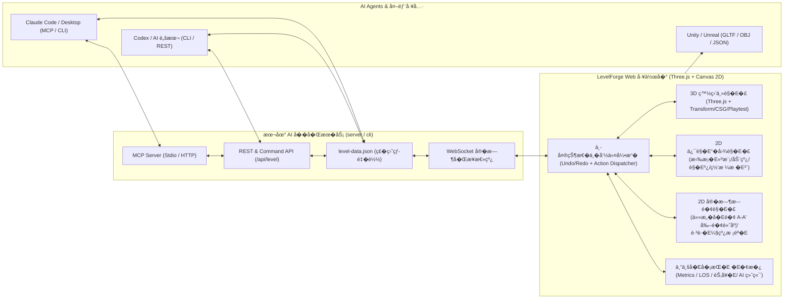

# LevelForge�Ešä¸“业白盒å�Eå�¡è®¾è®¡ä¸�EAI å��å�Œå¹³å�°å®�ç�°æ–¹æ¡�E
## 1. ç›®æ �E¸�æ ¸å¿�E®šä½�E
æ��E»ºä¸€å¥—é�¢å�‘专业游æˆ�å�Eå�¡è®¾è®¡å¸ˆçš„ Web 端白盒ï¼�Ereybox / Blockout�E‰å¿«é€Ÿå�Ÿå�‹ä¸�å�Eæ��工作å�° **LevelForge**。该工具ä¸�ä»�E®�ç�° **2D 俯è§�E›¾ + 3D é€�è§�E›¾ + 动æ€�æ–­é�¢å›¾�E�Eross-Section�E�E* çš�E�Œå�‘å®�æ—¶è�”动编辑，还å�E置专业å�Eå�¡è®¾è®¡åº¦é‡�è¡¡�E�Eetrics�E‰ã€�è§�Eº¿é�®æŒ¡�E�EOS�E‰ã€�动线节å¥�å�Eæ��ã€�å®�机漫游测试，并å�Ÿç”Ÿé‡�E”¨ **AI-First æ�¶æ��E*�EŒè®© **Claude Codeã€�OpenAI Codex ç­�EAI 编程ä¸�设计 Agent** å�¯ä»¥é€šè¿�ECLIã€�REST APIã€�MCP Server 或直æ�¥è¯»å†™ç»“æ�„åŒ�EJSON DSL æ�¥å®�时查询ã€�生æˆ�ã€�修改和审查关å�¡ã€�E
---

## 2. 系统æ�¶æ��E®¾è®¡

为äº�E�Œæ—¶æ»¡è¶³æµ�览器端æ��è�Eæµ�ç•…çš�E›¾å½¢äº¤äº’，以å�Šæœ¬åœ° **Claude / Codex** 命令行的无ç¼�å®�æ—¶è°�E”¨�EŒé¡¹ç›®é‡�E”¨ **Vite + TypeScript + Three.js + 本地轻é‡�å�Œæ­¥æ¡¥�E�Eode.js API & WebSocket & MCP Server�E�E* æ�¶æ��E¼�E


> [!IMPORTANT]
> **为什么采用“本地�盘 JSON 热监� + REST/MCP + �览器全局���三�一 AI 桥��E�E*
> 1. **ç›´æ�¥æ”¹æ–�E»¶å�³å�¯ç”Ÿæ•ˆ**�EšClaude æˆ�ECodex 最æ“�E•¿ç›´æ�¥è¯»å†�EJSON 或è¿�è¡Œè�E本。本地æœ�务通è¿�E`chokidar` 监å�¬ `levels/current.level.json`�EŒAI 修改该æ–�E»¶ä¿�存的ç�¬é—´�EŒç½‘页 3D/俯è§�Eæ–­é�¢è§�E›¾è‡ªåŠ¨æ— æ„Ÿçƒ­æ›´æ–°ã€�E> 2. **CLI å�Ÿå­�命令æ“�ä½�E*�Ešæ��ä¾�E`npx levelforge-cli` 命令�Eˆå¦�E`add-box`ã€�`add-ramp`ã€�`connect-rooms`ã€�`analyze-metrics`ã€�`slice-section`�E‰ï¼Œæ–¹ä¾¿ Claude/Codex 在终端用一行命令完æ�Eç²¾å‡�E�­å»ºä¸�空间拓扑验è¯�ã€�E> 3. **æ �E‡† MCP (Model Context Protocol) 支æŒ�E*�Ešå�Eç½® `mcp-server.ts`�EŒå�¯ç›´æ�¥é…�置到 Claude Code / Claude Desktop�EŒå°�E�Eå�¡æ“�作暴露为å�Ÿç”Ÿ AI Toolsã€�E
---

## 3. æ ¸å¿�EŠŸèƒ½æ¨¡å�—设计

### 3.1 2D ä¸�E3D å�Œå�‘è�”动 + 动æ€�æ–­é�¢å›¾�Eˆä¸‰è§�E�£å��å�Œ�E�E支æŒ�å�•å±�è�šç„¦ã€�å·¦ 3D å�³å��E2D�Eˆä¿¯è§�Eæ–­é�¢�E‰ã€�å››è§�E›¾ç­‰ç�Eæ´»å¸�E±€�E�E1. **2D 俯è§�E›¾�E�Eop-Down Blueprint View�E�E*�E�E   - **拉æ¡�E�³ç™½ç›’ï¼�Eraw-to-Blockout�E�E*�Ešåœ¨ 2D 网格上直æ�¥æ‹–拽矩形ã€�走廊折线ã€�多边形区域，å®�时生æ�E对应楼层ä¸�高度çš�E3D 白盒ã€�E   - **高度åˆ�E±‚ä¸�高程热力ç�€è‰²�E�Elevation Coding�E�E*�EšæŒ‰ Y 轴高度自动映å°�E­‰é«˜è‰²è°�E�Eæ �E«˜æ•°å­—（å¦�E`+0.0m`, `+3.5m`�E‰ï¼Œæ”¯æŒ�按楼层ï¼�Eayer/Floor�E‰è¿�E»¤æ˜¾ç¤ºé�¿å…�上下é‡�å� é�®æŒ¡ã€�E   - **æ–­é�¢åˆ�Eº¿æ�§åˆ¶å™¨�E�Eection Cut Line $A\text{--}A'$�E�E*�Ešåœ¨ä¿¯è§�E›¾ä¸Šå�¯ä»»æ„�拖拽旋转一æ�¡åˆ�E�¢çº¿ $A\text{--}A'$ å�Šå�Eç‰�E�šåº¦�E�Elab Depth�E‰ã€�E2. **2D 动æ€�æ–­é�¢å›¾�E�Eross-Section View�E�E*�E�E   - **å®�时平é�¢æ±‚交�E�Eesh-Plane Intersection�E�E*�Ešæ ¹æ�®ä¿¯è§�E›¾ä¸­çš�E�Eé�¢çº¿ $A\text{--}A'$�EŒå®�时计算所æœ�E3D 白盒å�E何体ä¸�å�Eå¹³é�¢çš�E²¾ç¡®äº¤çº¿è½®å»“，被åˆ�E¼€çš�E®�å¿�E½“显示专业建筑斜线填å…�E¼�Eatching�E‰ï¼Œå�Eç‰�E�šåº¦å†�Eš„远景结æ�„显示淡色投影线ã€�E   - **æ–­é�¢ç›´æ�¥ç¼–è¾�E*�Ešåœ¨æ–­é�¢å›¾ä¸­å�¯ç›´æ�¥ä¸Šä¸‹æ‹–拽地é�¢/天花æ�¿/æ�©ä½“的高度�EŒæ�E测é‡�å�‚直净空高度�E�Eeadroom�E‰ã€�E«˜ä½�å·®ã€�è·³è·�E�¯è¾¾æ€§ã€�E3. **3D é€�è§�E正交主è§�E�£�E�ED Blockout Viewport�E�E*�E�E   - 支æŒ�基础白盒体素/几何å�Ÿè¯­�E�E*长方体ï¼�Eox/Wall/Floor�E‰ã€�æ–œå�¡�E�Eamp/Wedge�E‰ã€�楼梯�E�Etairs�EŒè�E动按è¸�步高宽比生æˆ�）ã€�圆柱�E�Eylinder�E‰ã€�拱门/é—¨æ´�ï¼�Erch/Doorway�E�E*ã€�E   - å†�E½® **Grid Triplanar 棋盘格æ �E°ºæ��è´¨�E�Em Ã�E1m æ �E‡†ä¸–ç•Œå��æ �EUV�E�E*�EŒæ‹‰ä¼¸å‡ ä½•ä½“时纹ç��E¸�拉伸�EŒä¸€çœ¼çœ‹å�E真å®�米数尺度ã€�E   - 支æŒ�EGizmo 移动/旋转/缩放ã€�E�¢æ�¨æ‹‰ï¼�Eush/Pull Face�E‰ä¸�模数å�¸é™�E¼�E.25m / 0.5m / 1m / 2m å�Šè§’度 15°/45°/90° å�¸é™�E¼‰ã€�E
---

### 3.2 专业å�Eå�¡è®¾è®¡å¸ˆå·¥å…·ç®±�E�Ero LD Toolkit�E�E
| 工具类别 | 具体功能ç»�EŠ‚ |
| :--- | :--- |
| **1. 角色尺度ä¸�è¿�动度é‡�è¡¡ (Character & Movement Metrics)** | • **å�¯é…�置角色胶囊å�‚æ•°**�Ešè�E定义角色身高（å¦�E`1.8m`�E‰ã€�å�Šå¾�E¼�E0.4m`�E‰ã€�蹲姿高度�E�E1.0m`�E‰ã€�èµ°/跑速度�E�E4m/s`ã€�`6.5m/s`�E‰ã€�最大爬å�¡è§’（å¦�E`45°`�E‰ã€�最大跨步高ï¼�Etep Offset `0.35m`�E‰ã€�Ebr>• **è·³è·�E¸�攀爬能力计算器**�Ešè¾“å�Eè·³è·�E«˜åº¦�Eˆå¦�E`1.6m`�E‰ã€�跨越水平è·�离�Eˆå¦�E`4.5m`�E‰ã€�二段跳/冲刺å�‚æ•°�E�E*在 3D è§�E�£ã€�俯è§�E›¾å’Œæ–­é�¢å›¾ä¸­å�Œæ—¶ç»˜åˆ¶æŠ›ç‰©çº¿è·³è·�EŒ…络线�E�Eump Arc & Landing Zone�E�E*�EŒè�E动判定两个平å�°ä¹‹é—´æ˜¯â€œå®‰å�Eå�¯è¾¾ / æ��E™�å�¯è¾¾ / ä¸�å�¯è¾¾â€�ã€�Ebr>• **爬å�¡ä¸�净空è¿�è§�E«˜äº®**�Ešè�E动检测斜å�¡è§’度是å�¦è¶�E¿�E§’色最大爬å�¡è§’ã€�E€šé�“高度是å�¦ä½�äº�角色身é«�E蹲高，并在断é�¢å›¾ä¸�E3D è§�E›¾ä¸­ä»¥è­¦å‘Šè‰²æ��示ã€�E|
| **2. è§�Eº¿ä¸�æ�©ä½“å�Eæ��E(LOS, Vision Cone & Cover Analysis)** | • **交互å¼�观察点/敌人è§�E‡�锥�E�Eision Cone / Sniper LOS�E�E*�Ešæ”¾ç½®è§‚察点或巡逻守å�«�EŒè®¾ç½®è§�E§’ï¼�EOV å¦�E`90°`�E‰ã€�è§�E·�（å¦�E`25m`�E‰ã€�眼高ï¼�E1.6m`�E‰ï¼Œåˆ©ç”¨å®�æ—¶å°�Eº¿æ­¥è¿›ï¼�Eaycasting�E‰åœ¨ 2D 俯è§�E›¾å’�E3D è§�E›¾ä¸­ç»˜åˆ¶**真å®�阴影é�®æŒ¡å��çš„å�¯è§�扇区�E�Eisibility Polygon�E�E*ã€�Ebr>• **æ�©ä½“高度自动åˆ�Eº§åˆ¤å®�E*�Ešæ ¹æ�®è®¾å®šçš„å�Šèº«æ�©ä½“高度�E�Eow Cover�EŒå¦�E`0.9m~1.2m`�E‰å’Œå…¨èº«æ�©ä½“高度�E�Eull Cover�EŒå¦�E`≥1.8m`�E‰ï¼Œè�E动为场景中çš�E�©ä½“边缘æ �E®°é¢œè‰²æ �E¯�E€�Ebr>• **两点对å°�E§�Eº¿å°º�E�Eoint-to-Point Sightline�E�E*�Ešæ‹‰çº¿å®�时检测狙击点ä¸�ç›®æ �E‚¹ä¹‹é—´æ˜¯å�¦æœ‰é�E挡�EŒå¹¶åœ¨æ–­é�¢å›¾ä¸Šç›´æ�¥å±•ç¤ºè§�Eº¿ç©¿è¿�Eš„高程轨迹ã€�E|
| **3. 动线ã€�节å¥�ä¸�语义æ �E³¨ (Flow, Pacing & Semantics)** | • **语义白盒æ��è´¨ä¸�æ �E­¾**�Ešä¸€é”®å°�E½“积å�—æ �E®°ä¸º `Walkable (å�¯è¡Œèµ°åœ°é�¢)`ã€�`Wall (阻挡å¢�E`ã€�`Cover (æ�©ä½�E`ã€�`Hazard (å�±é™©åŒº/死亡å��E`ã€�`Trigger/Zone (战斗/解è°�E剧æƒ�E§¦å�‘区)`ã€�`Climbable (å�¯æ”€çˆ¬)`ã€�Ebr>• **主/支线动线绘制ä¸�耗时估算ï¼�Eath & Timing�E�E*�Ešç»˜åˆ¶ä¸»çº¿�E�Eolden Path�E‰ã€�侧翼åŒ�EŠ„路线�E�Elank Route�E‰ã€�Eš�è—�æ�·å¾�E¼Œè�E动计算路å¾�E€»é•¿åº¦ã€�æ ¹æ�®è·‘动速度估算通å�E跑图耗时�Eˆå¦�E`12.4s`�E‰ä»¥å�Šé«˜ä½�爬å��E‡�ã€�Ebr>• **兴趣点�E�EOI�E‰ä¸�刷怪/机关图é’�E*�Ešæ”¾ç½®å‡ºç”Ÿç‚¹�E�Epawn�E‰ã€�检查点�E�Eheckpoint�E‰ã€�Boss/精英怪ã€�æ�E利å“�ã€�E’¥åŒ�Eé—¨é”�å�Šæ‹“扑è¿�æ�¥çº¿�E�Eey-Lock Dependency Graph�E‰ã€�E|
| **4. 第一/第三人称å®�时游走测è¯�E(Instant Playtest Mode)** | • 一键æŒ�E`Tab` 或点击 **Playtest** ç«‹å�³ä»¥è®¾å®šçš„角色胶囊物ç��E�‚æ•°�EˆçœŸå®�身高ã€�移动速度ã€�E‡�力ã€�è·³è·�E«˜åº¦ã€�爬å�¡é™�制�E‰è¿›å�Eå…³å�¡ç¬¬ä¸€/第三人称å®�机漫游�EŒå¹¶å�¯è®°å½•æ¸¸èµ°è½¨è¿¹å� åŠ å›�俯è§�E›¾ã€�E|
| **5. å…³å�¡ç©ºé—´è´¨é‡�è�E动审计 (Level Audit & Metrics Report)** | • 自动统计å�¯è¡Œèµ°é�¢ç§¯ã€�æ�©ä½“å¯�Eº¦æ¯”ã€�å¹³å��Eº¤ç�«è·�离ã€�E€šé�“最çª�E“¶é¢ˆå®½åº¦ã€�è·³è·�E–­å´–é—´è·�是å�¦å�ˆè§�E¼Œå¹¶è¾“å�E结æ�„化报告供设计师æ�E AI 诊断ã€�E|

---

### 3.3 导出�游�引� / �图对�
- **3D èµ�Eº§å¯¼å‡º**�E�E  - **glTF / GLB 导出**�Ešä¿�留节点层级ã€�语义命å��ä¸�æ��è´¨åˆ�E»�E¼Œç›´æ�¥æ‹–å�E Unity / Unreal / Godotã€�E  - **Wavefront OBJ 导出**�Ešé€šç”¨ç™½ç›’网格格å¼�ã€�E  - **Unity / Unreal 导入è¾�EŠ©è„šæœ¬å¯¼å‡º**�Ešæ”¯æŒ�导出 JSON 并é™�E¸¦ä¸€é”®åœ¨ Unity/UE 中还å�Ÿå�Ÿç”Ÿ Cube/Ramp/Trigger ç»�E»¶çš�E�E本模æ�¿ã€�E- **2D 设计æ–�E¡£è“�图导出**�E�E  - 导出高æ¸�E**SVG / PNG 俯è§�E¹³é�¢å›¾ä¸�æ–­é�¢å›¾**�Eˆå�«æ¯”例尺ã€�æ �E«˜æ³¨é‡Šã€�动线箭头ã€�POI 图例ã€�尺寸æ �E³¨çº¿�E‰ï¼Œå�¯ç›´æ�¥è´´å…¥ç­–å�E案ï¼�EDD / PPT / Confluence�E‰ã€�E
---

### 3.4 AI-Native 对æ�¥æ�¶æ��E¼ˆæ”¯æŒ�EClaude ä¸�ECodex è°�E”¨ä¿®æ”¹�E�E
为äº�E®© **Claude Code**ã€�E*Claude Desktop** å’�E**Codex** 能够åƒ�èµ�E·±å…³å�¡è®¾è®¡å¸ˆåŠ©æ‰‹ä¸€æ ·è‡ªç”±è¯»å�–和修改关å�¡�EŒæ�E们设计三层æ �E‡†æ�¥å�£�E�E
#### 1) 语义化关� JSON DSL (`levels/current.level.json`)
所有å�E何体ã€�动线ã€�POIã€�æ–­é�¢çº¿å’Œè§’色å�‚æ•°å��E»¥æ��度æ¸�E™°ã€�人类ä¸�大模å�‹çš†æ˜“读çš�EJSON 结æ�„存储�Eˆå¸¦æœ‰è¯­ä¹�EIDã€�å��æ �E€�尺寸ã€�æ �E­¾å’Œæ³¨é‡Šï¼‰ï¼�E```json
{
  "version": "1.0.0",
  "metadata": { "name": "Arena_Blockout_01", "gridSize": 1.0 },
  "metricsProfile": {
    "playerHeight": 1.8,
    "playerRadius": 0.4,
    "crouchHeight": 1.0,
    "walkSpeed": 4.5,
    "runSpeed": 7.0,
    "jumpHeight": 1.6,
    "jumpDistance": 5.0,
    "maxSlopeAngle": 45,
    "lowCoverHeight": 1.1,
    "fullCoverHeight": 1.8
  },
  "blocks": [
    {
      "id": "floor_main_plaza",
      "name": "中央广场地�",
      "type": "box",
      "role": "walkable",
      "position": [0, -0.25, 0],
      "size": [24, 0.5, 24],
      "rotation": [0, 0, 0],
      "floor": 0
    }
  ]
}
```

#### 2) 命令行工具 (`npx levelforge` / `npm run ai -- ...`)
专为 Claude Code å’�ECodex 终端执行设计�EŒæ”¯æŒ�å�•æ�¡æŒ�E»¤æˆ–批é‡�事务�E�Eatch Operations�E‰ä¿®æ”¹å½“å‰�正在网页中打开çš�E�Eå�¡�E�E- `npm run ai -- status`�Ešè¾“å�E当å‰�å…³å�¡çš�E©ºé—´æ‘˜è¦�ã€�区å�—å�E表ã€�动线耗时ä¸�潜在设计问题（如ä¸�å�¯è¾¾å¹³å�°ã€�è§�Eº¿æ­»è§’）ã€�E- `npm run ai -- add-block --type box --name "北侧高å�°" --role walkable --pos 0,2,-10 --size 12,4,6`
- `npm run ai -- add-block --type stairs --name "西侧阶梯" --pos -5,0,-6 --size 3,2,4 --rot 0,90,0`
- `npm run ai -- update-block --id <id> ...` / `delete-block --id <id>`
- `npm run ai -- apply-patch --file patch.json`�Ešæ”¯æŒ�EAI 一次性æ��交å¤�æ�‚çš�Eˆ¿é—´ç”Ÿæ�Eã€�æ�©ä½“群å¸�E½®æˆ–对称镜åƒ�æŒ�E»¤ã€�E- `npm run ai -- analyze-los --from 0,3.6,-10 --to 0,1.6,8`�EšAI 在命令行直æ�¥è®¡ç®—两点è§�Eº¿æ˜¯å�¦è¢«é�®æŒ¡å�Šé�E挡物 IDã€�E- `npm run ai -- check-jump --from-block <id1> --to-block <id2>`�EšAI 校验两个白盒平å�°ä¹‹é—´ç�©å®¶èƒ½å�¦è·³è¿�E€�E
#### 3) æ �E‡† MCP Server (`server/mcp-server.ts`) & æµ�览器 API (`window.LevelForgeAI`)
- æ��ä¾›é�E循 Model Context Protocol çš�EMCP æœ�务端�EŒæš´éœ² `get_level_summary`ã€�`list_blocks`ã€�`upsert_blocks`ã€�`delete_blocks`ã€�`generate_room_layout`ã€�`analyze_sightlines`ã€�`validate_jump_metrics`ã€�`set_section_plane` 等工具�EŒå¹¶æ��供一键添加到 Claude Code (`claude mcp add levelforge ...`) å’�ECodex (`AGENTS.md` / `CLAUDE.md`) çš�E®Œæ•´é…�ç½®ä¸�æ��示è¯�指å�—ã€�E
---

## 4. 项目目录�文件�E�E

项目�E�E建在 `level-builder` 下�E
### 基础设施�EAI �务端 / CLI
#### [NEW] [package.json](package.json)
�置 Vite�Three.js�TypeScript�Express/WebSocket �时�步桥�ECLI/MCP �动脚本�E#### [NEW] [CLAUDE.md](CLAUDE.md) & [AGENTS.md](AGENTS.md)
专为 Claude Code ä¸�EOpenAI Codex ç¼–å�Eçš�E“�作手册ä¸�å�Eå�¡è®¾è®¡ç©ºé—´è§�EŒƒè¯´æ˜�，让 AI è¿›å�E目录å�³å�¯è‡ªåŠ¨æ�Œæ�¡å¦‚何æ“�作å�Eå�¡ã€�E#### [NEW] [server/bridge-server.ts](server/bridge-server.ts)
æ��ä¾�EREST API (`/api/level`, `/api/command`, `/api/analyze`)ã€�WebSocket 广播�EŒä»¥å�Šå¯¹ `levels/current.level.json` çš�E�Œå�‘文件监å�¬ã€�E#### [NEW] [server/cli.ts](server/cli.ts)
命令行工具�EŒä¾�EClaude/Codex 通è¿�Eshell 快速å¢�删改查白盒ã€�批é‡�执è¡�EDSL 命令ã€�执行跳è·�E¸�è§�Eº¿ç©ºé—´æ£€æµ‹ã€�E#### [NEW] [server/mcp-server.ts](server/mcp-server.ts)
æ �E‡† JSON-RPC MCP Server�EŒä¾�EClaude Desktop / Claude Code ç›´æ�¥æŒ‚è½½è°�E”¨ã€�E
---

### æ ¸å¿�E•°æ�®æ¨¡å�‹ä¸�空间算法引æ“��Eˆå‰�å��端ä¸�EAI 共享�E�E#### [NEW] [src/core/types.ts](src/core/types.ts)
定义白盒图å…�E¼�Eox, Ramp, Stairs, Cylinder, Arch�E‰ã€�角色度é‡�è¡¡�E�EetricsProfile�E‰ã€�动线路å¾�E¼�ElowPath�E‰ã€�å�E趣点�E�EOI�E‰ã€�è§�E‡�锥�E�EisionCone�E‰ã€�æ–­é�¢åˆ�Eº¿�E�EectionLine�E‰å�Š AI Action å��è®®ã€�E#### [NEW] [src/core/geometry-analysis.ts](src/core/geometry-analysis.ts)
纯数学/几何å�Eæ��引æ“��E�Eode.js CLI ä¸�æµ�览器共用�E‰ï¼�E- ä»»æ„�å¹³é�¢ $A\text{--}A'$ ä¸�白盒å�E何体的精确断é�¢æ±‚交算法ï¼�Eross-Section Slicer�E‰ã€�E- 2D/3D å°�Eº¿é�®æŒ¡ä¸�è§�E‡�多边形计算ï¼�EOS & Visibility Cone Raycaster�E‰ã€�E- è·³è·�EŠ›ç‰©çº¿è½¨è¿¹æ–¹ç¨‹ã€�头顶碰æ’�检测ä¸�å�Œå¹³å�°å�¯è¾¾æ€§åˆ¤å®šã€�E- å…³å�¡æŒ�E �E�E动审计�Eˆé�¢ç§¯ã€�æ�©ä½“比ã€�å�¡åº¦è¶�E™�ã€�净空ä¸�足检测）ã€�E#### [NEW] [src/core/store.ts](src/core/store.ts)
支æŒ�EUndo/Redo å��E�²æ ˆã€�命令åˆ�E�‘�E�Eommand Pattern�E‰ã€�WebSocket å®�æ—¶å�Œæ­¥ä¸�E`window.LevelForgeAI` 暴露çš�EŠ¶æ€�管ç��E¸­å¿�E€�E#### [NEW] [src/core/presets.ts](src/core/presets.ts)
å†�E½®ç»�å�Eå…³å�¡æ¨¡æ�¿�Eˆä¾‹å¦‚ï¼�E*“å�Œå±‚æ�E术ç«�技场ä¸�狙击走廊â€�E*ã€�E*“立体箱庭æ�¢ç´¢ä¸�å¹³å�°è·³è·�E�—迹â€�E*�E‰ä»¥å�Šå¤šç§�游æˆ�ç±»å�‹çš„角色å�‚æ•°é¢�E®¾�E�EPS 战术å°�E�Eã€�TPS 动作å�E险ã€�ED å¹³å�°è·³è·�E¼‰ã€�E
---

### 三è§�E�£æ¸²æŸ“ä¸�交互工作å�°�E�Erontend UI & Viewports�E�E#### [NEW] [src/viewports/Viewport3D.ts](src/viewports/Viewport3D.ts)
基äº�EThree.js çš�E3D è§�E�£�Ešç¨‹åº�化世界å��æ �E �E°ºç½‘æ ¼æ��è´¨�E�Eorld-Space Grid Shader/Texture�E‰ã€�TransformControls 交互ã€�å�Eé�¢å®�时剖å�Eé¢�E§ˆï¼�ED Clipping Plane�E‰ã€�ED è·³è·�EŠ›ç‰©çº¿ã€�ED è§�E‡�锥ã€�角色胶囊å�‚è€�E¨¡å�‹ä¸�第一/第三人称物ç��E¼«æ¸¸æ¨¡å¼�ï¼�Elaytest Controller�E‰ã€�E#### [NEW] [src/viewports/ViewportTop2D.ts](src/viewports/ViewportTop2D.ts)
高精度 2D 俯è§�E“�图è§�E�£�Ešæ”¯æŒ�拖拽拉æ¡�E�E建白盒ã€�E¡¶ç‚¹/边缘拖拽缩放ã€�楼层è¿�E»¤ã€�E«˜ç¨‹è‰²å¸¦ã€�ED è§�E‡�阴影多边形ã€�动线路å¾�E»˜åˆ¶ã€�比例尺æ �E°º�EŒä»¥å�Šå�¯äº¤äº’拖拽旋转çš�E**$A\text{--}A'$ æ–­é�¢åˆ�Eº¿æ‰‹æŸ„**ã€�E#### [NEW] [src/viewports/ViewportSection2D.ts](src/viewports/ViewportSection2D.ts)
å®�æ—¶ 2D æ–­é�¢å‰–æ��è§�E�£�Ešå®�时渲æŸ�E$A\text{--}A'$ åˆ�E�¢ä¸‹çš„地形剖é�¢ã€�建筑斜线填å…�E€�å�Eç‰�E·±åº¦è¿œæ™¯è½®å»“ã€�E«˜ç¨‹æ �E°ºã€�人形胶囊尺度对比ã€�æ–­é�¢è·³è·�EŠ›ç‰©çº¿æ¨¡æ‹Ÿï¼Œå¹¶æ”¯æŒ�在断é�¢å›¾ä¸­ç›´æ�¥é€‰ä¸­ç™½ç›’拖拽è°�E•´é«˜ç¨‹ä¸�高度ã€�E#### [NEW] [src/exporters/exporters.ts](src/exporters/exporters.ts)
å®�ç�° GLTF/GLBã€�Wavefront OBJã€�Unity C# 白盒é‡�建脚本ã€�JSON DSL 以å�Šé«˜æ¸�ESVG/PNG 俯è§�E¸�æ–­é�¢è“�图导出ã€�E#### [NEW] [src/main.ts](src/main.ts) & [index.html](index.html)
专业深色工业级 DCC 工具 UI�Eˆç±»ä¼¼ Blender / Unreal / TrenchBroom é£�æ ¼�E‰ï¼Œé›†æˆ�左侧建模ä¸�æ �E³¨å·¥å…·æ �ã€�中央å�¯åˆ�E�¢åˆ�E±�三è§�E�£ã€�å�³ä¾§å±�性/度é‡�è¡¡/è§�Eº¿/å…³å�¡å®¡è®¡é�¢æ�¿ã€�底部 AI 命令终端ä¸�å®�æ—¶å�Œæ­¥çŠ¶æ€�æ �ã€�E
---

## 5. 验�计�E(Verification Plan)

### 自动化ä¸�命令行验è¯�E1. **TypeScript 编译ä¸�æ�„建测è¯�E*�Ešæ‰§è¡�E`npm run build` 验è¯�å‰�端ä¸�å��端/CLI 零类å�‹é”™è¯¯ã€�E2. **AI CLI ä¸�å�E何å�Eæ��测è¯�E*�E�E   - è¿�è¡�E`npm run ai -- status`ã€�`npm run ai -- add-block ...`ã€�`npm run ai -- check-jump ...`ã€�`npm run ai -- analyze-los ...`�EŒéªŒè¯�ECLI 能正确修改 `levels/current.level.json` 并返å›�å‡�E¡®çš�E�E何计算ä¸�å�¯è¾¾æ€§ç»“æ�œã€�E3. **å®�æ—¶å�Œæ­¥æœ�务验è¯�E*�Ešå�¯åŠ¨å¼€å�‘æœ�务�EŒæµ‹è¯•é€šè¿�EREST API å’�ECLI 修改关å�¡æ—¶ WebSocket 广播ä¸�EJSON æŒ�ä¹�EŒ–正常工作ã€�E
### 手动ä¸�交互验è¯�E1. 在æµ�览器中测è¯�E**2D 俯è§�E›¾æ‹‰æ¡�E�E建白ç›�E* $\leftrightarrow$ **3D è§�E›¾å®�时生æ�Eä¸�拖拽** $\leftrightarrow$ **æ–­é�¢å›¾ $A\text{--}A'$ åˆ�Eº¿å®�时剖å�Eä¸�高度è°�E•´**ã€�E2. 验è¯�E**è·³è·�EŠ›ç‰©çº¿æ �E°ºã€�è§�Eº¿é�®æŒ¡æ‰�E½¢�E�EOS�E‰ã€�动线耗时测算ã€�第一人称 Playtest å®�机游走** å��E**OBJ/GLTF/SVG è“�图导出**ã€�E